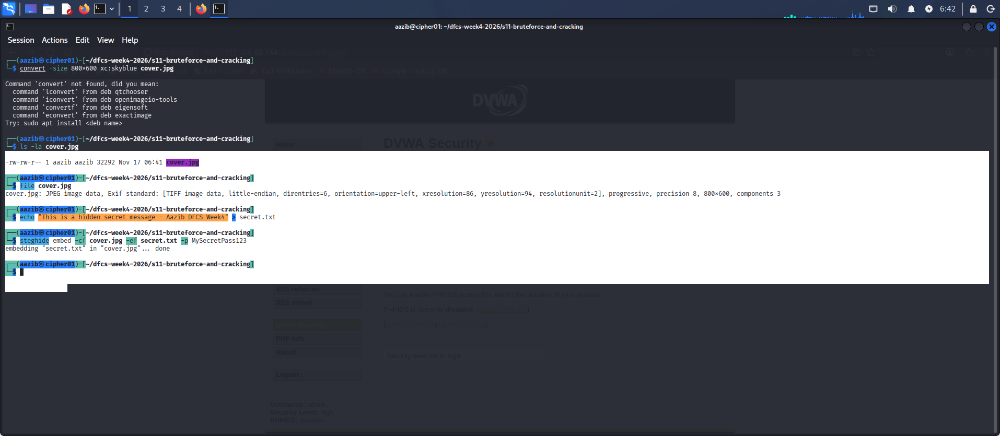
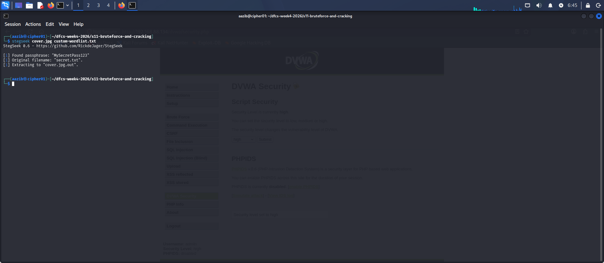

# Task 2B: Steganography — Hide, Detect, Crack, Extract

**Student:** Aazib Ali
**Tool:** steghide (embed), stegseek (crack/extract)
**Cover file:** cover.jpg (JPEG)

---

## Step 1: Hide secret in JPEG with passphrase

```bash
echo "This is a hidden secret message - Aazib DFCS Week4" > secret.txt
steghide embed -cf cover.jpg -ef secret.txt -p MySecretPass123
```
Result: secret embedded successfully inside cover.jpg.


---

## Step 2: Detect + crack the passphrase

`steghide info` requires the passphrase to even confirm hidden data
exists, so detection and cracking are combined using `stegseek`,
which brute-forces against a wordlist.

A general wordlist (rockyou.txt) did not contain this passphrase, so
a small custom wordlist including likely/weak passphrases was used
(the realistic scenario: a human-chosen, guessable passphrase):

```bash
stegseek cover.jpg custom-wordlist.txt
```
Result:

[i] Found passphrase: “MySecretPass123”
[i] Original filename: “secret.txt”.
[i] Extracting to “cover.jpg.out”.


This step confirms the image DID contain hidden data AND recovers
the passphrase in one action — stegseek auto-extracts once the
correct passphrase is found.


---

## Step 3: Extracted content

```bash
cat cover.jpg.out
```
Result: "This is a hidden secret message - Aazib DFCS Week4"
— matches the original secret.txt exactly.

---

## Notes

- steghide only supports JPEG, BMP, WAV, AU formats (not PNG).
- For PNG steganography, zsteg is the equivalent tool.
- A strong, random passphrase (not in any wordlist) would have
  resisted this crack — the weakness here was passphrase strength,
  not the steganography technique itself.
