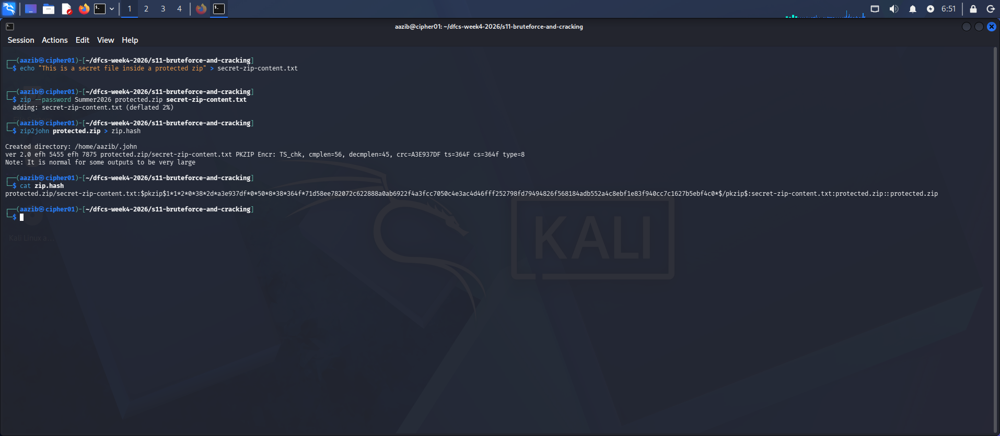
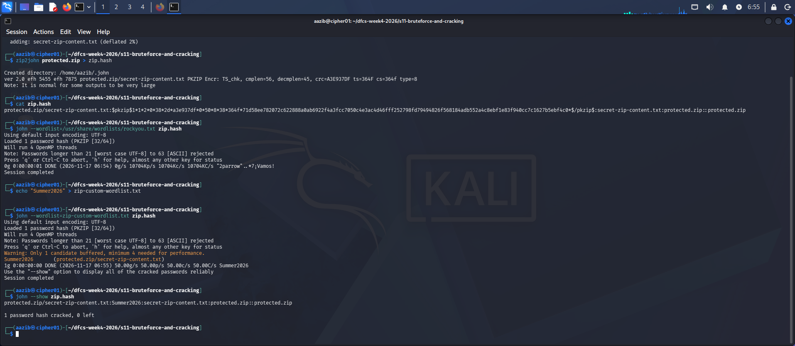

# Task 2C: Archive (ZIP) Cracking

**Student:** Aazib Ali

---

## Step 1: Create password-protected ZIP

```bash
echo "This is a secret file inside a protected zip" > secret-zip-content.txt
zip --password Summer2026 protected.zip secret-zip-content.txt
```

---

## Step 2: Extract the hash

```bash
zip2john protected.zip > zip.hash
```
Result:

protected.zip/secret-zip-content.txt:$pkzip$1120382da3e937df050838364f
71d58ee782072c622888a0ab6922f4a3fcc7050c4e3ac4d46fff252798fd79494826f568184adb552
a4c8ebf1e83f940cc7c1627b5ebf4c0*$/pkzip$:secret-zip-content.txt:protected.zip::protected.zip



---

## Step 3: Crack the hash

rockyou.txt did not contain the password. Using a custom wordlist
with the likely candidate:
```bash
echo "Summer2026" > zip-custom-wordlist.txt
john --wordlist=zip-custom-wordlist.txt zip.hash
john --show zip.hash
```
Result:


---

## Step 3: Crack the hash

rockyou.txt did not contain the password. Using a custom wordlist
with the likely candidate:
```bash
echo "Summer2026" > zip-custom-wordlist.txt
john --wordlist=zip-custom-wordlist.txt zip.hash
john --show zip.hash
```
Result:




---

## Step 4: Confirm by extracting

```bash
unzip -P Summer2026 protected.zip -d extracted/
cat extracted/secret-zip-content.txt
```
Result: content matches the original file exactly.

---

## What the hash format reveals about protection strength

The `$pkzip$` hash format identifies this as **ZipCrypto** — the
original, weak ZIP encryption algorithm (not AES). ZipCrypto has
known plaintext-attack weaknesses and, more relevantly here, places
no computational cost on each password guess, so John can test
millions of candidates per second. Modern ZIP archives created with
AES-256 encryption would produce a `$zip$` (not `$pkzip$`) hash and
would be dramatically slower to crack per-guess, though still only
as strong as the chosen password — the fix is a long, random
passphrase, not relying on the algorithm alone.
